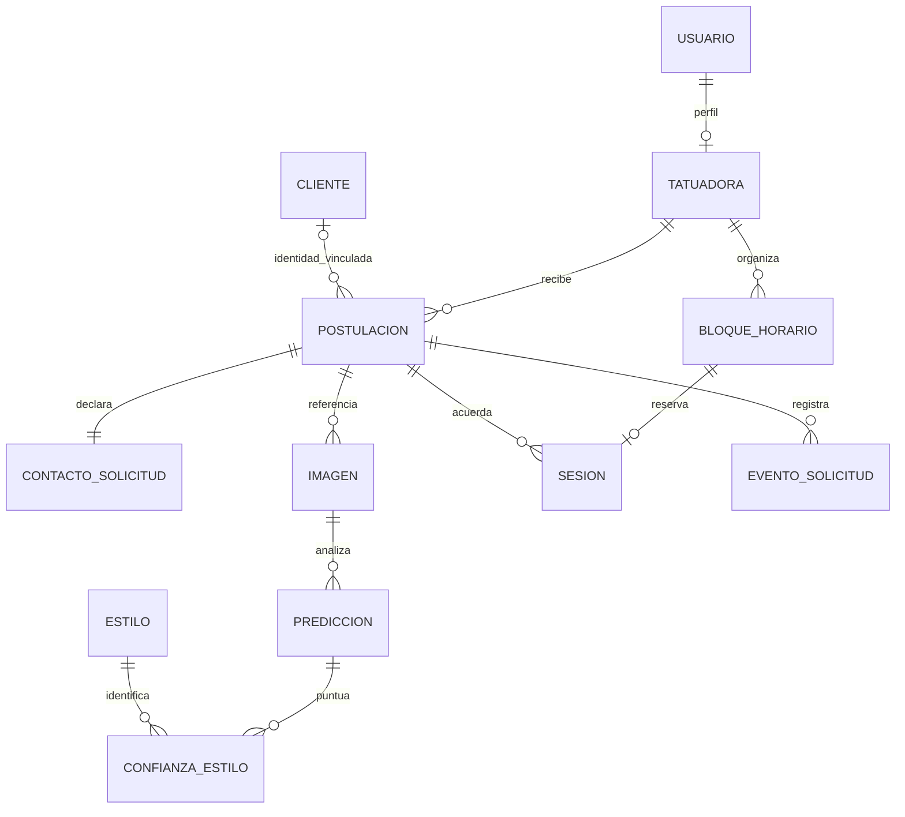

# Normalización y validaciones — revisión del 5 de noviembre de 2026

## Alcance y criterio

Se corrigió el modelo de negocio de Django utilizado por SQLite. El criterio de tercera forma normal (3FN) se aplica al esquema y a las dependencias funcionales declaradas; no depende de cambiar SQLite por PostgreSQL. Las pruebas comprueban comportamiento e integridad, pero por sí solas no demuestran normalización.

Para cada dependencia no trivial `X → A`, 3FN requiere que `X` sea superclave o que `A` sea atributo primo. La revisión siguiente considera las claves candidatas además de los ID artificiales. Los campos temporales de creación/actualización y las referencias de auditoría pertenecen al registro que describen.

## Cambios respecto del DER y del incremento anterior

1. **Atributos de la solicitud:** `descripcion` contiene solamente la idea. `color`, `nivel_detalle` y `cobertura` tienen columnas propias. No se codifican opciones de negocio dentro de una cadena que luego deba descomponerse. Las opciones antiguas desconocidas permanecen NULL; no se inventan valores.
2. **Medidas:** se conservan `alto_cm` y `ancho_cm`. Área y categoría se calculan al consultar; ya no hay columnas persistidas para `area_cm2` ni `categoria_tamano`. Se eliminan las dependencias redundantes `(alto, ancho) → área → categoría` del almacenamiento. Los umbrales de categoría siguen siendo 25/150/625 cm².
3. **Sesiones:** se eliminan `Postulacion.bloque` y `BloqueHorario.postulacion`. `Sesion(bloque_id PK/FK, postulacion_id FK)` es la única relación entre solicitud y reserva. Permite varias sesiones sin duplicar la relación ni almacenar nuevamente la tatuadora dentro de Sesion. Un bloque tiene como máximo una sesión; la misma profesional debe ser dueña del bloque y destinataria de la solicitud.
4. **Nombres de tatuadora:** el nombre público se obtiene de Usuario. Se elimina la copia automática `Tatuadora.nombre`. Solo un valor histórico distinto se conserva como `nombre_artistico`, atributo opcional independiente; no sustituye el nombre público ni se actualiza al editar el nombre civil.
5. **Contacto e identidad:** `ContactoSolicitud` contiene la declaración de contacto de un envío, con `postulacion_id` como clave primaria. El formulario anónimo ya no crea un Cliente nuevo por cada envío. `Postulacion.cliente` es opcional y permite vincular una identidad gestionada por el estudio; no se infiere identidad por correo. Las identidades y enlaces antiguos se preservan, y se copia su contacto a cada solicitud para mantener la información histórica. No se fusionan ni borran personas automáticamente.
6. **Archivos:** cada ruta de Imagen es única, además de ser único el par `(postulacion, orden)`. Existe como máximo una imagen principal por solicitud. El archivo permanece privado y no se traslada de carpeta durante la migración.

El DER previo dibujaba área, categoría y un único bloque en Postulacion. Por tanto, hay que actualizar esas partes del diagrama y del diccionario de datos en el informe; mantener el dibujo anterior no describiría la implementación corregida.

## Dependencias funcionales revisadas

`atributos` significa los atributos no clave propios de esa entidad, no los atributos de las entidades referenciadas.

| Relación | Claves y dependencias consideradas | Justificación |
|---|---|---|
| Usuario | ID, UUID, nombre_usuario y email únicos → atributos de cuenta | No se copian atributos de cuenta en las solicitudes. `is_staff` se deriva del rol. |
| Cliente | ID → datos de identidad/contacto actuales; RUT único cuando informado | Un correo no prueba identidad ni se declara clave de persona. No se crean identidades desde envíos anónimos. |
| ContactoSolicitud | postulacion_id PK → nombre/alias, apellidos, correo y teléfono declarados | Es una declaración histórica de ese envío, no una copia sincronizada de Cliente. No depende del cliente vinculado. |
| Tatuadora | ID o usuario_id único → nombre artístico opcional, activa y fecha | Los datos civiles dependen de Usuario y se consultan allí; el alias independiente no es una copia automática. |
| Postulacion | ID o referencia UUID → destinataria, identidad vinculada opcional, idea, opciones, medidas, decisiones, importes y fechas | No contiene nombres de otras entidades ni área/categoría calculadas ni un bloque duplicado. |
| BloqueHorario | ID o referencia UUID → profesional, fecha, intervalo, tipo, estado y nota | No almacena la solicitud, eliminando la dependencia transitiva solicitud → profesional dentro del bloque. |
| Sesion | bloque_id PK/FK → postulacion_id | Cada reserva se vincula una vez; una solicitud puede tener varias sesiones. |
| Imagen | ID, ruta única o (postulacion_id, orden) → metadatos del archivo | El orden depende de la solicitud; las claves alternativas identifican el mismo archivo registrado. |
| Estilo | ID o código único → nombre, descripción y condición de catálogo | La descripción del estilo se mantiene en su catálogo. |
| Prediccion | ID o (imagen_id, version_modelo) → resultado observado, umbral aplicado, tiempo y fecha | Es la salida histórica de esa inferencia. El umbral pertenece a la ejecución; no se declara constante por versión. |
| ConfianzaEstilo | ID o (prediccion_id, estilo_id) → confianza | La confianza depende de ambos componentes; no se almacenan nombres de estilos en las filas de puntuación. |
| EtiquetaConsolidada | ID o imagen_id único → estilo confirmado, revisora y datos de revisión | Una revisión consolidada por imagen. |
| TatuadoraEstilo | ID o (tatuadora_id, estilo_id) → dominio | El dominio depende de la combinación completa, no de un estilo o profesional aislados. |
| TrabajoPortafolio | ID → profesional, estilo, título, archivo y publicación | Cada trabajo es una entidad independiente. |
| EventoSolicitud | ID → solicitud, actor, tipo, relato y fecha del evento | Es auditoría histórica; su texto no se analiza para reconstruir datos operativos. |

**1FN:** los atributos operativos son valores escalares y las colecciones (imágenes, estilos, sesiones, eventos) tienen filas separadas. Un nombre compuesto o una descripción libre siguen siendo un valor del dominio; no se dividen arbitrariamente por espacios.

**2FN:** las relaciones con claves candidatas compuestas no almacenan atributos dependientes de un solo componente. Por ejemplo, ConfianzaEstilo no copia el nombre del estilo, y TatuadoraEstilo no copia el nombre de la tatuadora.

**3FN:** bajo las dependencias anteriores, los atributos no clave pertenecen a la entidad identificada por la clave; las referencias permiten consultar atributos de otras entidades sin copiarlos. No quedan las dependencias persistidas de área/categoría ni solicitud/profesional dentro de BloqueHorario.

### Repetición de valores y datos históricos

Normalizar no significa que un nombre o correo jamás pueda aparecer dos veces. Dos contactos de envíos distintos pueden declarar el mismo correo sin ser la misma persona, y el contacto original de una solicitud no debe cambiar cuando se edite una identidad. Esa semántica justifica ContactoSolicitud.

El precio sugerido y la predicción se conservan como observaciones históricas, no se recalculan al cambiar tarifas o modelos. `confianza_maxima` es parte de la salida registrada; el vector puede ser parcial según el proveedor. No se presume que todo resultado pueda reconstruirse a partir de las puntuaciones disponibles. El estado y los importes actuales de una solicitud tampoco se obtienen analizando los textos del historial.

## Validaciones implementadas

| Capa | Controles |
|---|---|
| Formulario público | Campos obligatorios, opciones cerradas, correo, nombre/alias sin controles ni saltos de línea, teléfono opcional de 7–15 dígitos, textos sin caracteres de control ocultos, medidas finitas y límites decimales. |
| Archivos | Se mantienen JPG/PNG reales, límites de bytes/píxeles, decodificación, exclusión de formatos disfrazados/animados y recodificación sin EXIF; nombres internos aleatorios y acceso privado. |
| Operaciones de negocio | La agenda y la gestión vuelven a validar entradas, aunque se invoquen sin la vista. Acuerdo antes del abono, abono verificado antes de reservar, fechas válidas de Santiago, disponibilidad, intervalos sin solapes y propiedad de la profesional. |
| Cambios simultáneos | Bloqueo/transacción por profesional, comprobación de versión de la solicitud y del horario. El formulario de gestión exige versión; no pisa silenciosamente cambios de otra ventana. |
| Reenvíos | Se conserva el token único de recepción. Registrar otra vez el mismo abono acumulado no duplica su verificación ni su evento. |
| Base de datos | Medidas positivas y dentro del rango; importes válidos y abono no mayor al precio; coherencia de abono verificado; estados/opciones permitidos; tipo/estado de bloque coherentes; ruta y principal de imagen únicas; metadatos positivos; confianza/umbral entre 0 y 1; coherencia profesional de Sesion. |
| Administración | Solicitudes, contactos declarados, archivos, predicciones, agenda, sesiones e historial quedan en consulta desde Django Admin. La operación se hace desde las vistas que aplican las reglas. El usuario de un perfil existente no se reasigna desde ese formulario administrativo. |
| HTTP | Se conservan autenticación, autorización por registro, CSRF, escape de HTML, CSP y no-cache de datos privados. Los errores de gestión preservan los datos del formulario. |

La protección de sesiones también se aplica a inserciones/cambios directos en SQLite mediante triggers. PostgreSQL tiene la variante correspondiente en las migraciones, pendiente de ensayo real en RDS. Un operador con privilegios para eliminar restricciones o cambiar directamente la base queda fuera de la frontera de seguridad del flujo web.

## Migración, pruebas y límites

- `0007`: crea ContactoSolicitud/Sesion, traslada datos, separa opciones y retira columnas redundantes. Si área/categoría o relaciones antiguas son contradictorias, aborta sin corregirlas silenciosamente. Un texto libre anterior se conserva íntegro.
- `0008`: restricciones de integridad y unicidad. Los triggers de agenda se retiran/reinstalan explícitamente al reconstruir tablas SQLite.
- `0009`: integridad de las asociaciones de sesiones al insertarlas y al modificar la profesional de un bloque o solicitud.
- Ensayo reproducible: `scripts/verificar_migracion_normalizacion.py`, con una SQLite temporal. Comprueba dos sesiones de la misma solicitud, contacto, descripción/opciones, importes, UUID e imagen. Con `--inconsistente` comprueba el rechazo y rollback de datos contradictorios.
- Pruebas de recepción, buzón, aislamiento entre cuentas, agenda, concurrencia, CSRF, escape de HTML, archivos y nuevas restricciones se ejecutan sobre bases temporales.
- No se reescriben migraciones ya aplicadas `0001–0006`. `0007` no admite una reversión automática con pérdida de información: la restauración requiere respaldo de código y base compatibles.
- Se conserva SQLite para la presentación local. No se agrega React, HTMX, polling, AWS, RDS ni S3 en este cambio. No se alteran las claves ni el proveedor de ML.

Esto documenta la normalización bajo las reglas de negocio declaradas y la verificación local. No constituye una certificación de seguridad ni una prueba del despliegue PostgreSQL/AWS. Si cambian las dependencias de negocio, debe revisarse nuevamente la normalización.

## DER actualizado del flujo principal

## Resultado de esta ejecución

243 pruebas Django aprobadas sobre SQLite. Ensayo con datos históricos (contactos, dos sesiones, importes e imagen) aprobado; ensayo de inconsistencia y rollback aprobado. Migración de una copia reciente de la SQLite del escritorio aprobada, con comparación de los campos conservados de todas las tablas de negocio/cuentas/sesiones e integridad referencial correcta. No hay cambios de modelos pendientes de migración. El servicio ML no se modificó en esta revisión.
